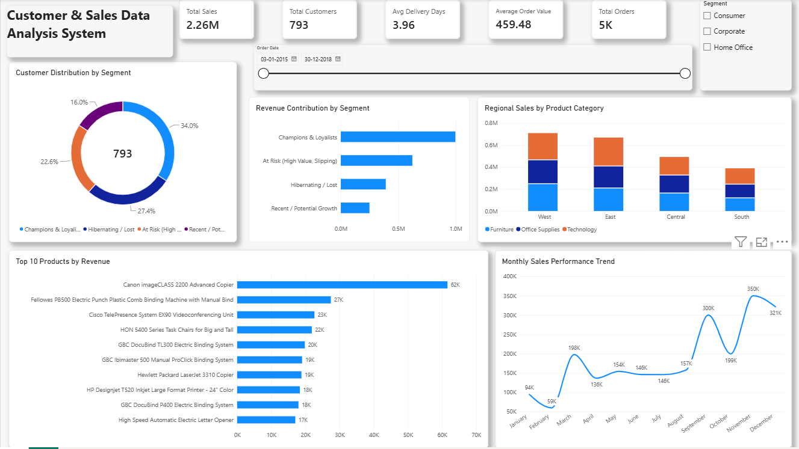

# Customer & Sales Data Analysis System

An end-to-end data analytics and business intelligence project demonstrating data hygiene, RFM customer segmentation, and an interactive executive Power BI dashboard for retail sales optimization.

---

## 📌 Executive Summary
* **Domain:** Retail & Customer Analytics
* **Tools Used:** Python (Pandas, NumPy), Microsoft Power BI Desktop, DAX, Excel/CSV
* **Data Scale:** 9,800 transaction records across 793 unique customers
* **Fulfillment Efficiency:** 3.96 Average Delivery Days

---

## 📊 Key Performance Indicators (KPIs)
| Metric | Value |
| :--- | :--- |
| **Total Revenue** | **$2.26M** ($2,261,536.78) |
| **Total Orders** | **4,922** (~5K distinct orders) |
| **Unique Customers** | **793** |
| **Average Order Value (AOV)** | **$459.48** |
| **Average Delivery Time** | **3.96 Days** |
| **Top Grossing Product** | Canon imageclass 2200 Advanced Copier ($61K+) |

---

## 🖼️ Power BI Dashboard Preview


### Core Visuals & Analytical Features:
1. **Executive KPI Cards:** Real-time visibility into Gross Sales, Orders, Customer Base, AOV, and Fulfillment Lead Time.
2. **RFM Customer Segmentation (Donut Chart):** Distribution of buyers across behavioral cohorts (*Champions*, *Recent Growth*, *At Risk*, and *Hibernating*).
3. **Revenue by Segment (Bar Chart):** Sales contribution per RFM tier.
4. **Regional Sales Performance (Stacked Bar):** Breakdown across West (~$0.73M), East (~$0.68M), Central (~$0.50M), and South (~$0.40M).
5. **Product Category Distribution:** Technology and Office Supplies leading commercial sales volume.
6. **Dynamic Slicers:** Interactive filtering by Date Range, Order Region, and Customer Segment.

---

## 🛠️ Data Pipeline & Methodology

### 1. Data Cleaning & Preprocessing (`scripts/clean_sales.py`)
* **Deduplication:** Audited and verified unique transaction IDs across 9,800 records.
* **Missing Value Imputation:** Handled missing postal codes and customer details systematically.
* **Date Parsing:** Standardized non-uniform timestamps across `Order Date` and `Ship Date` using dynamic parsing (`format='mixed'`).
* **Feature Engineering:** Calculated fulfillment duration: 'Shipping\_Days = Ship Date - Order Date'
* **Data Validation:** Stripped non-numeric currency symbols from `Sales` and verified positive transaction values.

### 2. Behavioral RFM Customer Segmentation
Using median split logic in Python, each unique customer was evaluated across three core behavioral metrics:
* **Recency ($R$):** Days elapsed since the customer's last purchase date relative to the snapshot cutoff.
* **Frequency ($F$):** Total count of unique orders placed (`DISTINCTCOUNT(Order ID)`).
* **Monetary ($M$):** Total lifetime spend (`SUM(Sales)`).

| Segment Tier | Behavioral Profile | Strategic Focus |
| :--- | :--- | :--- |
| **Champions & Loyalists** | Low Recency, High Frequency, High Monetary | Retention, VIP perks, exclusive loyalty rewards |
| **Recent / Potential Growth** | Low Recency, Lower Frequency, Moderate Spend | Cross-selling, product recommendation workflows |
| **At Risk** | High Recency (Inactive), High Historical Spend | Automated win-back campaigns, personalized discounts |
| **Hibernating / Lost** | High Recency, Low Frequency, Low Spend | Re-engagement surveys, price-sensitive promotions |

---

## 💡 Key Business Findings & Recommendations
* **Revenue Concentration:** The *Champions* cohort accounts for **34% of the customer base** but generates over **46% (~$1.05M)** of total revenue. Priority must be given to VIP loyalty programs.
* **Churn Mitigation:** Identified **179 high-value buyers in the *At Risk* cohort** accounting for over $580K in cumulative past spend. Immediate automated re-engagement workflows should be deployed to prevent account dormancy.
* **AOV Growth:** Deploy targeted bundling of high-frequency office supplies with enterprise hardware to raise Average Order Value above the $459.48 benchmark.

---

## 📂 Repository Organization
```text
├── data/
│   ├── sales_data.csv
│   └── cleaned_sales_rfm.csv
├── scripts/
│   └── clean_sales.py
├── dashboard/
│   └── Customer_and_Sales_Data_Analysis_System.pbix
├── screenshots/
│   └── dashboard_overview.png
├── Customer_and_Sales_Data_Analysis_Report_Kavyasree.pdf
└── README.md
